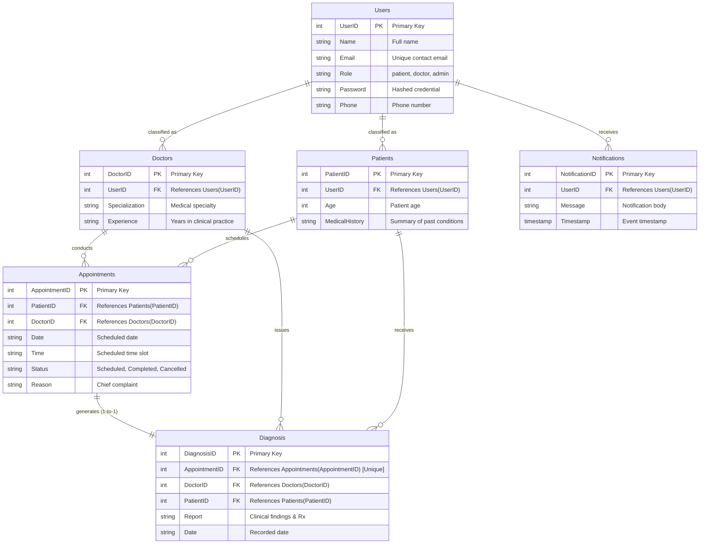

# 🏥 MedTrack - Official Entity-Relationship (ER) Diagram

This document details the normalized relational and cloud data architecture for the **MedTrack Healthcare Platform**, designed for deployment across **AWS EC2**, **Amazon DynamoDB**, and **AWS SNS**.

---

## 📊 Visual ER Diagram (Mermaid)

---

## 📋 Entity Specifications & Attributes

### 1. `Users`
- **Purpose**: Base entity for all platform actors (`Admin`, `Patient`, `Doctor`).
- **Attributes**:
  - `UserID` (PK): Unique identifier for each registered account.
  - `Name`: Full name of the user.
  - `Email`: Unique email address used for portal authentication.
  - `Role`: Access level identifier (`patient`, `doctor`, `admin`).
  - `Password`: Encrypted password hash (Werkzeug SHA-256).
  - `Phone`: Mobile contact number for SNS SMS alerts.

### 2. `Doctors`
- **Purpose**: Specialized profile for licensed medical professionals.
- **Attributes**:
  - `DoctorID` (PK): Unique physician identifier.
  - `UserID` (FK): Links to `Users.UserID`.
  - `Specialization`: Clinical field (e.g. Cardiology, Neurology, General Medicine).
  - `Experience`: Professional tenure.

### 3. `Patients`
- **Purpose**: Specialized profile for individuals seeking healthcare.
- **Attributes**:
  - `PatientID` (PK): Unique patient record number.
  - `UserID` (FK): Links to `Users.UserID`.
  - `Age`: Age of the patient.
  - `MedicalHistory`: Baseline medical background and chronic allergies.

### 4. `Appointments`
- **Purpose**: Connects patients with doctors for scheduled visits.
- **Attributes**:
  - `AppointmentID` (PK): Unique appointment tracking number.
  - `PatientID` (FK): Attending patient.
  - `DoctorID` (FK): Assigned physician.
  - `Date`: Calendar appointment date (YYYY-MM-DD).
  - `Time`: Allocated time slot (HH:MM).
  - `Status`: Appointment lifecycle state (`Scheduled`, `Completed`, `Cancelled`).
  - `Reason`: Chief complaint or reason for visit.

### 5. `Diagnosis`
- **Purpose**: Clinical record created by the doctor following consultation.
- **Attributes**:
  - `DiagnosisID` (PK): Unique medical report ID.
  - `AppointmentID` (FK, Unique): 1-to-1 relationship with the consultation.
  - `DoctorID` (FK): Attending doctor who authored the diagnosis.
  - `PatientID` (FK): Patient who received the diagnosis.
  - `Report`: Comprehensive clinical diagnosis, prescribed medication, dosage, and notes.
  - `Date`: Submission date.

### 6. `Notifications`
- **Purpose**: In-app and AWS SNS notification records.
- **Attributes**:
  - `NotificationID` (PK): Unique notification ID.
  - `UserID` (FK): Recipient user.
  - `Message`: Formatted alert content.
  - `Timestamp`: Time alert was emitted.
